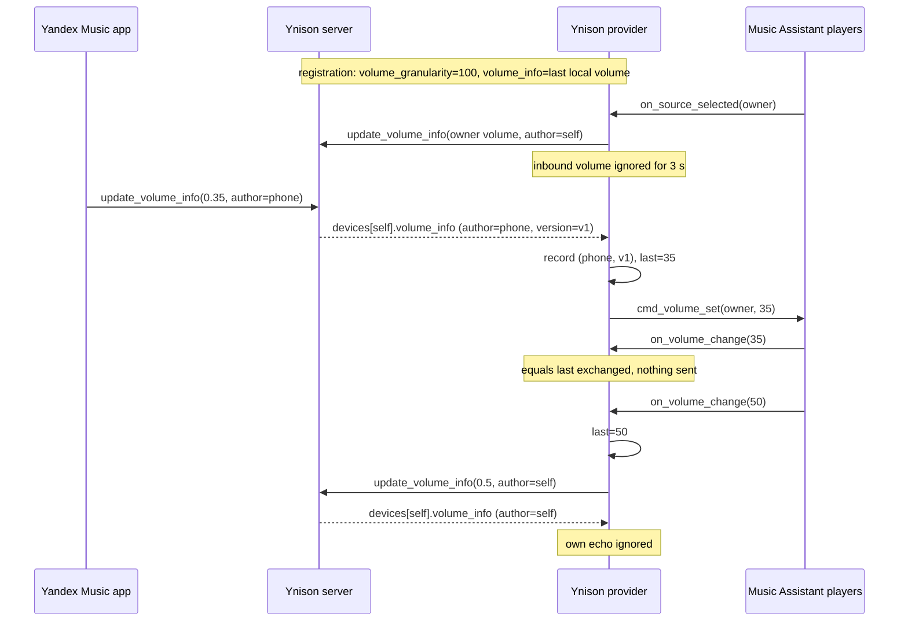

## Problem Statement

The Yandex Music app shows no usable volume slider for the Music Assistant
device. The Ynison registration advertises no remote volume control, so the
slider neither reflects the Music Assistant player's volume nor changes it, and
volume changes made in Music Assistant never reach the Yandex Music app
(issue #132).

## Solution Summary

The Ynison device registers with a 100-step volume scale and the latest known
Music Assistant volume. A dedicated client method publishes `update_volume_info`
for this device with a version block authored by it. Music Assistant volume
changes reach the provider through `on_volume_change` and are published to
Ynison. When a Yandex Music peer changes this device's `volume_info`, the
provider applies it to the player that owns the AudioSource session (a group
player for sync groups). The Music Assistant volume wins whenever the source is
selected on a player: it is pushed unconditionally, and inbound volume is
ignored for a short grace window after Ynison activates this device or the
source is selected. Own echoes, already-processed `(author, version)` pairs and
values equal to the last exchanged level are ignored, so neither side
ping-pongs. Volume synchronization is best-effort: a failed send or a failed
player command never breaks playback or the local volume change.

## Acceptance Criteria

1. Device registration (`update_full_state`) carries `volume_granularity: 100`
   and a `volume_info` with the latest local volume in `0.0..1.0` and a version
   block authored by this device; a reconnect publishes the latest value, not
   the initial default.
2. `on_volume_change(source_id, volume)` publishes `update_volume_info` for this
   device with `volume / 100` (rounded to 4 decimals, clamped) once per changed
   level; the same level repeated, or another source id, sends nothing.
3. A peer-authored `volume_info` change for this device, while Ynison has this
   device active and an AudioSource session is owned, calls
   `cmd_volume_set(owner_player_id, round(volume * 100))` exactly once; the
   resulting `on_volume_change` callback is not sent back to Ynison.
4. Inbound volume is ignored when it is authored by this device, when its
   `(author, version)` was already processed, when another device is active,
   when no session owner exists, inside the post-reconnect settle window, and
   for 3 seconds after this device becomes active or the source is selected.
5. On source selection, the owner player's volume (or group volume when the
   player has no own level) is pushed to Ynison without deduplication.
6. A failed Ynison send or a failed `cmd_volume_set` restores the previously
   exchanged level so the next change is not wrongly deduplicated, and never
   raises into Music Assistant's volume command or the Ynison message loop.
7. Existing playback, seek, transport, player-switch and stale-session tests
   remain green.

## Test Plan

- Client: registration contains granularity and normalized `volume_info`;
  `update_volume_info` builds the target device, clamped and rounded value,
  string-typed authored version and envelope, honours `strict`, and updates the
  value used by later registrations even when disconnected.
- State: `YnisonState.device_volume` extracts value and authorship, treats an
  omitted proto3 `volume` as `0.0`, and returns `None` for a missing device,
  missing `volume_info` or malformed payloads.
- Provider: MA → Ynison send and dedupe; foreign source ignored; send failure
  rollback; Ynison → MA `cmd_volume_set` on the owner with callback suppression;
  echo, repeated fingerprint, inactive device, no owner, grace windows and
  command failure are safe no-ops; source selection pushes the owner/group
  volume even when equal to the last exchanged level.
- Manual: mobile and web Yandex Music clients, regular player and sync group,
  rapid alternating changes from both sides, device switch, pause/resume,
  WebSocket reconnect, provider reload; confirm the 100-step slider against the
  live service.

## Sequence Diagram

