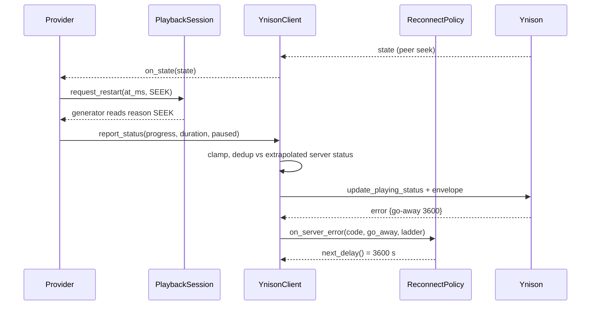

## Problem Statement

Comparing the provider with the official Yandex Music Android client
(2026.09.5, public decompilation and its `.proto` files) shows four places
where the provider behaves differently from Yandex's reference and where the
code is hard to change safely:

- Reconnect retries forever every 30 s with jitter, ignores the server's
  keep-alive parameters, and its policy is spread across the transport loop.
- Playing status is sent on a fixed 5 s timer even when nothing changed, some
  messages lack the request envelope (`rid`, action timestamp, interception
  type), and a user command with an unknown track duration reports success
  without sending anything.
- Queue edits are assembled from raw wire dictionaries inside the provider;
  RADIO queues grow without limit, unlike the official 200-item window, and
  passive devices may publish state they do not own.
- Track restart, seek, pause, and natural-end decisions are coordinated through
  about twenty loose fields and two events, which is where most recent playback
  fixes landed.

## Solution Summary

Move protocol policy below the Ynison client seam and give playback its own
state machine, mirroring the official client where it has an observable rule:

1. **Reconnect policy**: a pure policy object owns the retry ladder (server
   ladder or 1/5/30 s, no jitter), exact go-away waits, ladder reset on error
   key change and on a healthy session, no-retry classification by gRPC status,
   and a long idle retry once the ladder is exhausted (Music Assistant has no
   foreground or network trigger to wait for). The redirector's
   `keep_alive_params` drive the WebSocket heartbeat.
2. **Status reporter**: the client owns clamping, duration fallback, the
   request envelope on every message, own-unpaused interception, deduplication
   against the extrapolated server status (±2 s, same paused flag), and a strict
   send that waits up to 5 s for the channel and never reports a silent success.
3. **Queue commands**: advance, previous, repeat, shuffle, and RADIO append are
   client operations with typed outcomes; the provider no longer writes queue
   wire fields. Appends keep a 200-item window around the current item, and
   best-effort sends are gated on this device being active.
4. **Playback session**: one in-process module owns the source claim, stream
   cursor, restart requests with an explicit reason, the stop request, and the
   echo grace window. The audio generator consumes reasons instead of
   re-deriving them from flags.

Small protocol fixes ride along: `app_version` in the device header, no
`is_shadow` field, the `set-by-host-for-backward-compatibility` sentinel, and
re-sending `mute_events_if_passive` after losing activity.

## Acceptance Criteria

1. After the reconnect ladder is exhausted the client waits the idle interval
   between attempts instead of 30 s; a non-retryable gRPC status uses the idle
   interval immediately; server ladders and go-away windows are honoured exactly.
2. A `keep_alive_params.keep_alive_time_seconds` value in the redirect response
   becomes the state WebSocket heartbeat; without it the 30 s default applies.
3. Every outbound state message (`update_playing_status`, `update_active_device`,
   `update_session_params`, queue and full-state updates) carries `rid`,
   `player_action_timestamp_ms`, and `activity_interception_type`.
4. A best-effort status report equal to the extrapolated server status within
   2 s (same paused flag and duration) is not sent; changes in pause, duration,
   track, or a drift above 2 s are sent. Because the server then keeps a stale
   position, an inbound status that repeats the newest known status is never
   treated as a peer seek.
5. A strict status report with unknown duration raises instead of succeeding
   silently; a strict send on a disconnected channel waits up to 5 s for the
   reconnect before raising.
6. Unshuffled RADIO appends never publish more than 200 playable items unless
   the current item itself is further than that from the end; the current item
   and every item after it are preserved and the current index is shifted
   without restarting the playing item. Shuffled queues are not trimmed,
   because dropping original positions could drop items not yet played.
7. Best-effort status and queue publications are skipped while another device
   is active; strict user commands are not gated.
8. The provider no longer constructs `player_queue` or `status` wire objects;
   repeat mapping exists once.
9. Playback restart reasons (track change, seek, resume, repeat restart) and
   stop reasons (pause, session change, provider loss, terminal queue) are
   explicit session transitions; natural-end classification reads them.
10. The full test suite, `ruff`, `mypy`, and `pre-commit` pass; live behaviour
    is verified on the local instance before release.

## Test Plan

- Table-driven tests for the reconnect policy: ladder order, saturation into
  idle, go-away exactness and reset, error-key reset, healthy reset,
  no-retry classification.
- Client tests over a mocked WebSocket asserting wire messages: envelope
  presence, dedup window, strict waits and raises, interception type, gate.
- Integration test against the local aiohttp Ynison server for keep-alive
  parameters.
- Queue command tests on real client serialization (no re-implemented test
  double): outcomes for natural/explicit next, repeat modes, previous, shuffle,
  200-item window with and without shuffle.
- Playback session transition tests without an async generator; existing
  stream-loop tests keep covering natural-end and stop paths.
- Manual: local instance; play, pause, seek, next/previous, RADIO run past the
  queue end, reconnect after network loss.

## Sequence Diagram

## Data Model

- `ReconnectPolicy` (new, pure): `ladder: tuple[float, ...]`, `index: int`,
  `key: tuple[str, str] | None`, `go_away: float`, `idle_delay: float`.
- `RedirectInfo` (new): `host`, `ticket`, `session_id`,
  `keepalive_s: float | None`.
- `QueueOutcome` (new literal): `change | restart | stop | radio | failed`.
- `PlaybackSession` (new): `owner_player_id`, `consumer_player_id`,
  `session_id`, `track_id`, `index`, `restart: RestartRequest | None`
  (`at_ms`, `reason`), `stop_reason: StopReason | None`, `grace_until`,
  `externally_paused`, `progress_ms`, `duration_ms`.
- Wire: device header gains `app_version`; `UpdateDevice` drops `is_shadow`.
