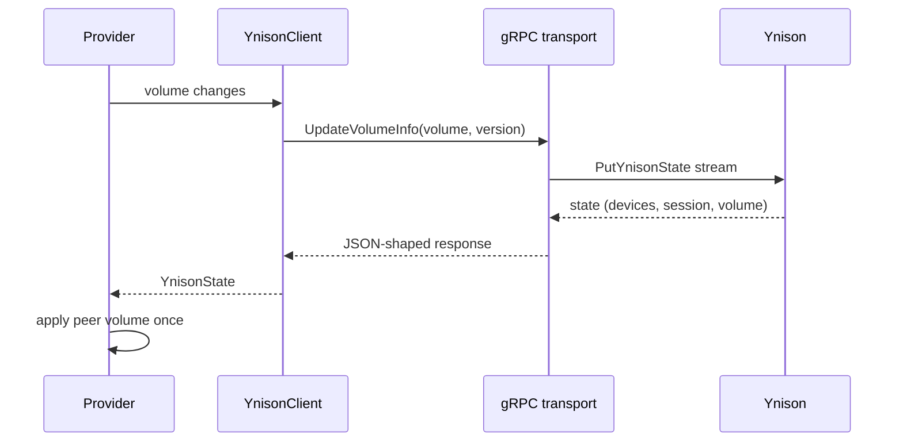

## Problem Statement

The stable plugin talks to Ynison through the WebSocket gateway. The official
Android client uses the native gRPC services on
`ynison.music.yandex.net:443`, and an earlier experimental branch only bridged
the existing JSON messages over that transport. That prototype does not cover
the rest of the published protocol: device capabilities and volume,
`UpdateVolumeInfo`, `UpdateVolume`, `UpdatePlayerQueueInject`, the active flag
and EOV request in `UpdateFullState`, response devices and sessions, the queue
edit commands, or the gRPC retry/back-off metadata. As a result the plugin
cannot present itself to remote clients with the same shape as the official
application even when the experimental transport is selected.

The live Ynison service is currently rejecting this account and device with
`500140000` and a long `go-away` window over both WebSocket and gRPC, so a live
end-to-end check cannot be the only acceptance gate. The protocol work must be
verifiable against the official schema and a local gRPC service.

## Solution Summary

Finish the experimental native transport as a complete implementation of the
Ynison gRPC contract: keep WebSocket as the default, send every request
variant the official schema defines, advertise device capabilities and volume,
publish volume changes in both directions, parse the response device list and
session, and implement the queue edit commands. Use grpcio with the schema
shipped in the Android application and keep the existing reconnect, echo and
playback policy below the transport seam.

## Acceptance Criteria

1. The gRPC redirector and state stream work against a local gRPC server, with
   `ynison-device-info` (base64, no padding), `ynison-device-id`,
   `ynison-redirect-ticket` and `ynison-session-id` metadata on the calls.
2. Every `PutYnisonStateRequest` oneof variant can be constructed and parsed:
   full state, active device, playing status, player state, volume, queue
   inject, session params, volume info and EOV sync.
3. Registration includes device info, `volume_granularity`, `volume_info` and
   the current volume; full state can mark the device active, request
   `INTERCEPT_IF_NO_ONE_ACTIVE` and embed an EOV queue id.
4. `UpdateVolumeInfo` is sent for local player volume changes, and a
   peer-authored device volume is applied to the streaming MA player exactly
   once (echoes do not loop).
5. Queue edits support add-next, add-last, remove-at and move, preserving the
   current occurrence and the shuffle permutation; each produces a valid
   `UpdatePlayerState` request.
6. A state response exposes the device list, active device, session and volume
   so callers do not have to re-parse raw JSON.
7. WebSocket remains the default transport and the existing test suite passes.
8. A live Ynison attempt made with a valid token is documented; the current
   server-side rejection is reported as an external blocker, not as a code
   failure.

## Test Plan

- `tests/test_grpc_protocol.py::test_fake_grpc_server_receives_metadata_and_state`
  pins real gRPC framing, metadata and a bidi state exchange against a local
  insecure gRPC server.
- `test_every_put_ynison_state_variant_round_trips` pins every oneof branch
  against the generated official schema.
- Client tests pin `UpdateVolumeInfo`, full-state activity/interception/EOV and
  the volume getter.
- `tests/test_provider.py::TestVolumeSync` pins both volume directions and the
  echo guard.
- `tests/test_queue_model.py` pins add-next/add-last/remove-at/move with a
  shuffled queue.
- Manual: select the gRPC transport on a local instance, confirm it attempts
  the redirect and records the returned go-away; this currently ends in
  Yandex's `500140000` rejection and is documented as an external blocker.

## Sequence Diagram

## Data Model

- `YnisonDeviceCapabilities` (new, frozen): `can_be_player`,
  `can_be_remote_controller`, `volume_granularity`.
- `YnisonClient` gains `_volume`, `_volume_version`, `_session_id` and the
  read-only `volume` / `session_id` properties.
- `YnisonDeviceInfo` is unchanged; `_build_device_dict` now emits `volume` and
  `volume_info` in addition to `info` and `capabilities`.
- `YnisonState.devices` is populated from `PutYnisonStateResponse.devices`;
  own-device `session.id` and `volume_info` are adopted into the client.
- No persisted configuration or library schema changes.
